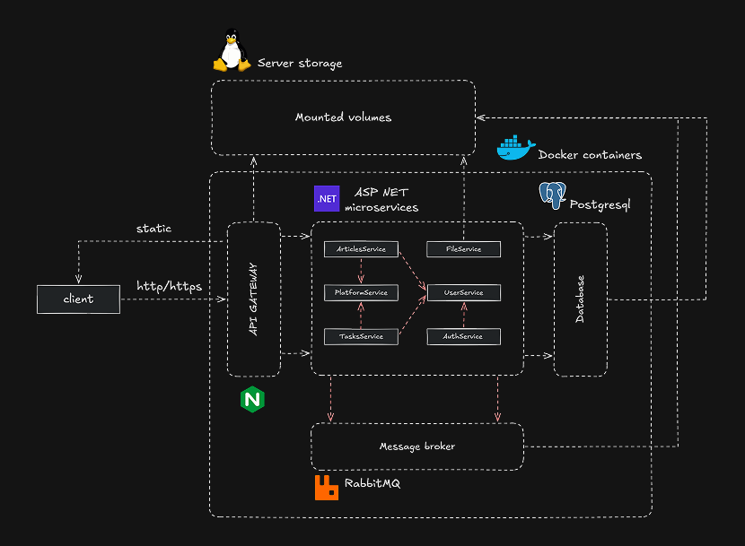
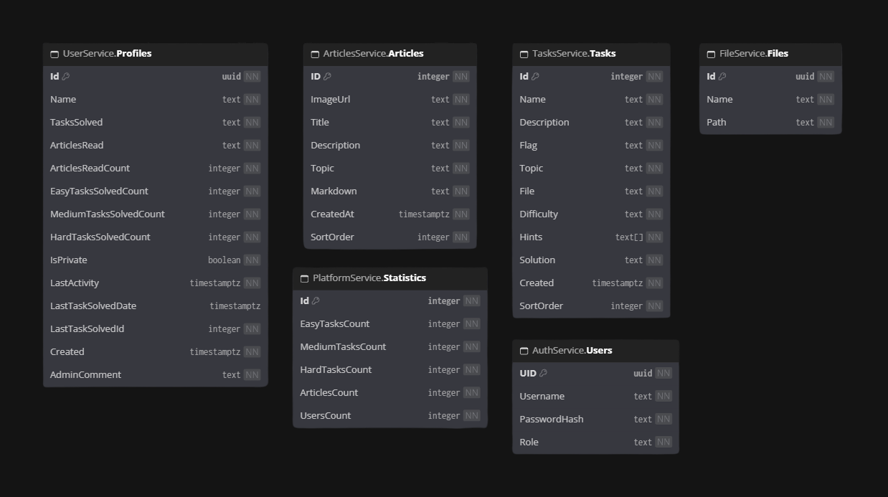
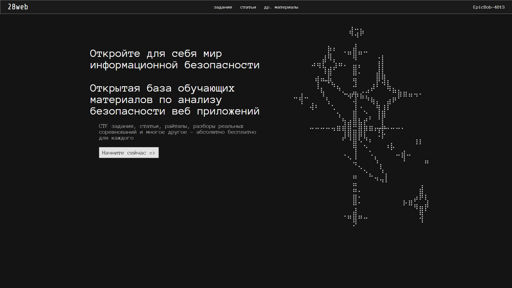
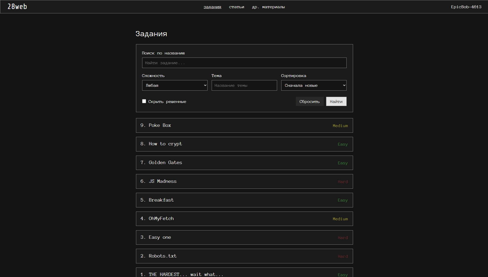
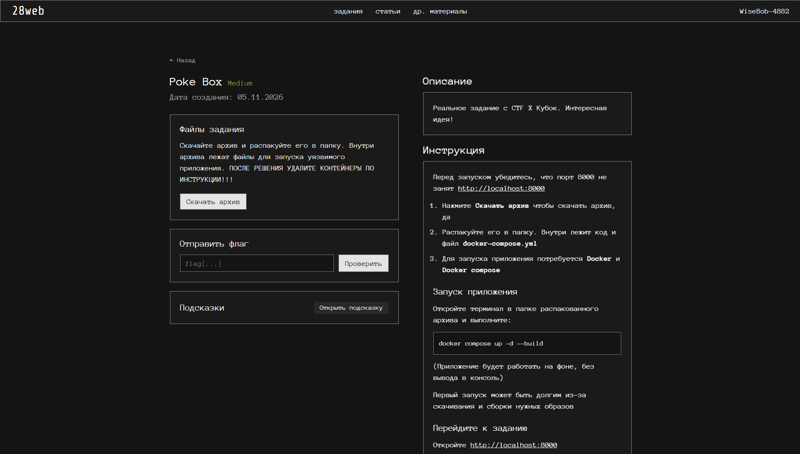
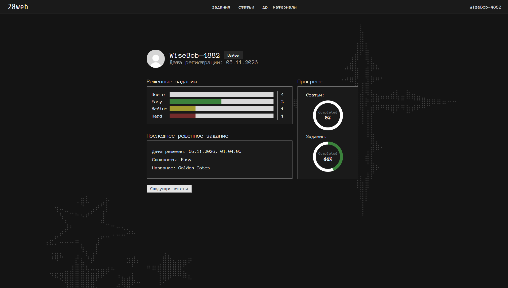

<div align="center">

  <p><strong>An open educational platform for those who want to learn cyber secutiry and practice ctf challenges</strong></p>
  <p>
    
    
    
    
    
  </p>
</div>

28web is an educational platform that provides CTF tasks, articles about cyber security and progress tracking features

The project is designed around a microservice-based backend. Each service owns a specific part of the platform, while Nginx provides a single public entry point for the static frontend and backend APIs

>**[!IMPORTANT]**
> Run downloadable challenge environments only in an isolated environment that you own. Stop and remove challenge containers when you have finished working with them

## Navigation

- [Features](#features)
- [Technology stack](#technology-stack)
- [Architecture overview](#architecture-overview)
- [Repository structure](#repository-structure)
- [Getting started](#getting-started)
- [API overview](#api-overview)
- [Screenshots](#screenshots)
- [License](#license)
- [Documentation](#documentation)
- [TODO](#todo)
- [Api Reference](docs/API.md)
- [Contributing](#contributing)

## Features

Practical security challenges

Learning materials

Profile and statistics

## Technology stack

| Area | Technology | Responsibility |
| --- | --- | --- |
| Frontend | HTML, CSS, Vanilla JavaScript | Browser interface and client-side interactions |
| Markdown rendering | Marked, DOMPurify | Rendering and sanitizing Markdown content in the browser |
| Backend | ASP.NET Core, .NET 9, C# | REST API endpoints and application logic |
| Database | PostgreSQL 16 | Persistent data storage for backend services |
| ORM and migrations | Entity Framework Core, Npgsql | Database access and schema migrations |
| Messaging | RabbitMQ, MassTransit | Asynchronous communication through domain events |
| Reverse proxy | Nginx | api gateway and static file hosting |
| Containers | Docker, Docker Compose | Building and running the application services |
| CI/CD | GitHub Actions, SSH | Deploying the application to a remote host |

## Architecture overview

Project diagram:



Data models:



The application is composed of six backend services and a static frontend. Nginx is the public entry point, it serves frontend files and forwards `/api/*` requests to the backend services

| Component | Main responsibility |
| --- | --- |
| **AuthService** | Account registration, sign-in, JWT issuance, and initial administrator seeding |
| **UserService** | User profiles, profile statistics, tracking articles progress and solved-tasks progress |
| **ArticlesService** | Article listing and filtering and administrator content management |
| **TasksService** | CTF task listing, filtering, task details, flag validation, and administrator task management |
| **FileService** | File downloads, administrator uploads, Markdown materials delivery |
| **PlatformService** |  Platform statistics, including user, article, and task counts |
| **Nginx gateway** | Static frontend hosting, HTTPS handling, API reverse proxying |
| **RabbitMQ** | Delivery of asynchronous events between backend services |

Each backend service is split into four layers: Web API, Application, Domain, and Infrastructure. The services use separate PostgreSQL databases, which keeps their data and migrations independently owned

RabbitMQ is used for event-driven updates. For example, account creation and task-solving events are consumed by the user and statistics services so that progress and aggregate counters can be updated without making the HTTP request responsible for every operation.


## Repository structure

```text
.
├── .github/
│   └── workflows/
│       └── deploy.yml              # GitHub Actions deployment workflow
├── assets/                         # README banner and architecture diagrams
├── gateway/
│   ├── Dockerfile
│   └── nginx.conf                  # Nginx routing and TLS configuration
├── src/
│   ├── frontend/                   # Static HTML, CSS, JavaScript, Markdown
│   └── backend/
│       ├── ArticlesService/
│       ├── AuthService/
│       ├── FileService/
│       ├── PlatformService/
│       ├── Shared/                 # Shared event contracts
│       ├── TasksService/
│       └── UserService/
├── static_storage/                 # Files mounted into the FileService container
├── _28web.sln
├── docker-compose.yml
└── README.md
```

Each backend service contains its own `*.WebApi`, `*.Application`, `*.Domain`, and `*.Infrastructure` projects where those layers are implemented

## Getting started

### Prerequisites

For the containerized setup, install:

- [Git](https://git-scm.com/)
- [Docker Engine](https://docs.docker.com/engine/) or [Docker Desktop](https://www.docker.com/products/docker-desktop/)
- [Docker Compose](https://docs.docker.com/compose/)

If you plan to build or run backend projects directly from your development environment, install the [.NET 9 SDK](https://dotnet.microsoft.com/download/dotnet/9.0)

### Clone the repository

```bash
git clone https://github.com/Katz386/IVR-ITProject.git
cd IVR-ITProject
```

### Prepare environment variables

Create a local `.env` file from the provided template:

```bash
cp .env.example .env
```

Edit `.env` before starting the application. Set unique credentials for sensitive services

### TLS configuration

The current Nginx configuration is production-oriented. It redirects HTTP traffic to HTTPS and expects Let\`s Encrypt certificate files for `28web.xyz`. Remove HTTPS support from the Nginx config or modify it so that it works with your domain

>`Ssl_CertPath` must point to the host directory that contains the `live/` certificate directory

## Running the platform

After configuring `.env` and preparing the TLS certificate directory, build and start the app:

```bash
docker compose up -d --build
```

To stop the app without deleting data:

```bash
docker compose down
```

To remove database volumes, use the volume-removal option, only when you want to delete the stored data:

```bash
docker compose down --volumes
```

## API overview

All backend APIs are exposed through the Nginx gateway under `/api`

| API prefix | Service
| --- | --- |
| `/api/auth` | AuthService
| `/api/user` | UserService
| `/api/articles` | ArticlesService
| `/api/tasks` | TasksService
| `/api/files` | FileService
| `/api/platform` | PlatformService
| `/api/health` | Nginx

Protected endpoints expect a JWT in the standard HTTP authorization header:

```http
Authorization: Bearer <JWT>
```

See the [API Reference](docs/API.md) for endpoint methods, query parameters, authorization requirements, and request examples

## Documentation

| Document | Description |
| --- | --- |
| [API Reference](docs/API.md) | Public API routes, query parameters, authorization, and request examples |

## TODO:
- Add automated unit and integration tests
- Add a Swagger specification for the HTTP APIs
- Add health checks for each backend service
- Add structured logging, metrics, and WAF
- Implement rate limiting

## Contributing

Contributions that improve the platform, its content, or its documentation are welcome. Please,include screenshots for meaningful frontend changes. Contact me (@bob4606) if you want me to add your tasks to the platform

## Screenshots





## License

Copyright (c) 2026 Anton S.

This project is licensed under the
PolyForm Noncommercial License 1.0.0.

You may use, modify and distribute this
software for non-commercial purposes
under the terms of the license.

Commercial use requires separate
written permission from the copyright
holder.

See the [LICENSE](./LICENSE) file
for the full license text.

All rights to the project name and logo
are reserved.