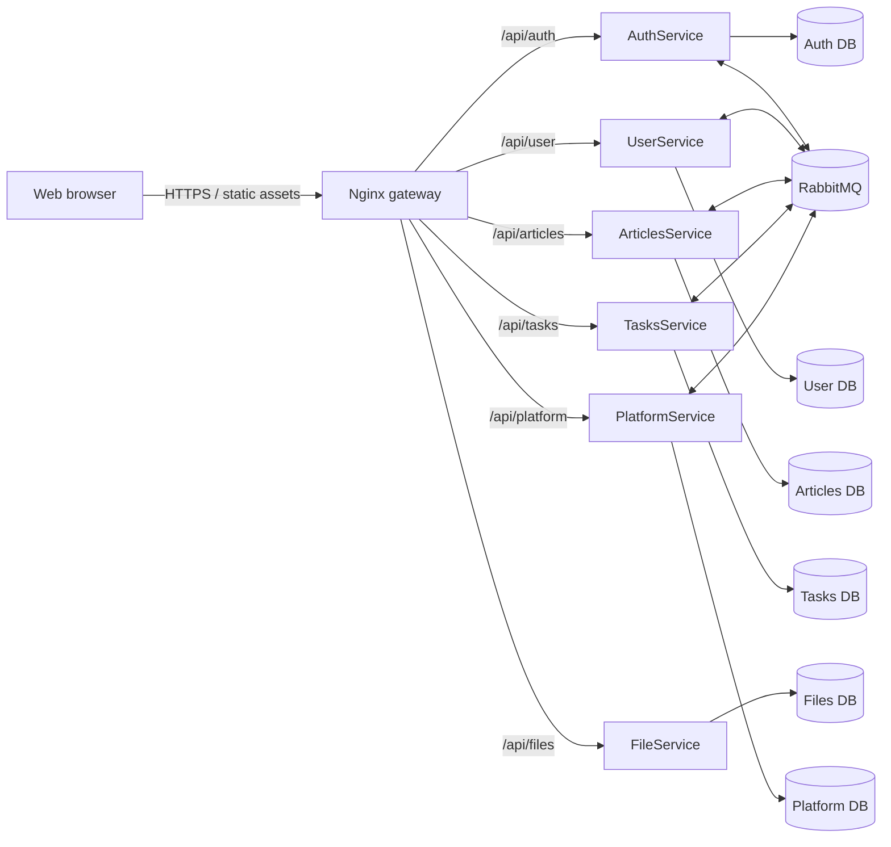
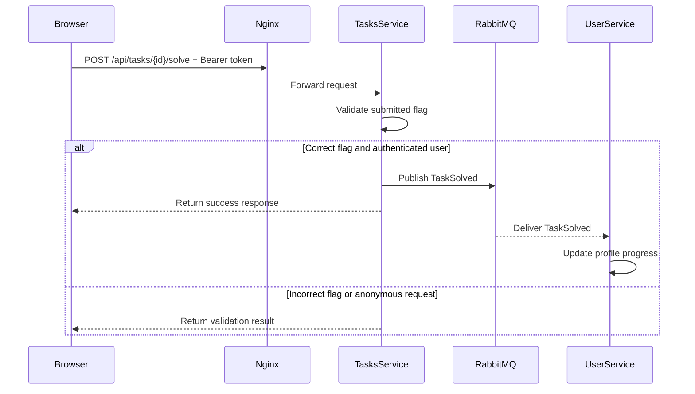
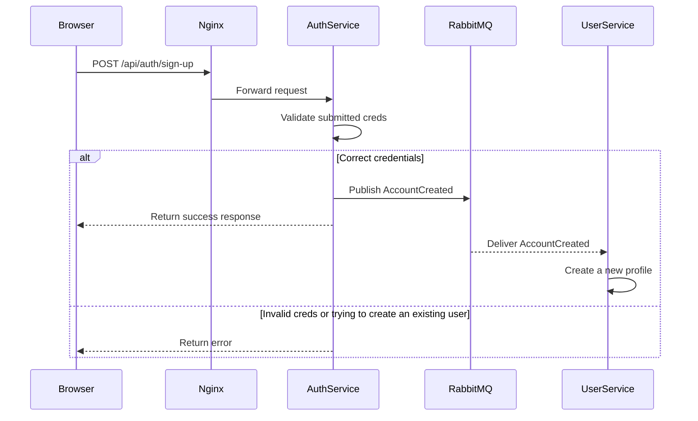

# Api Reference

## Navigation

- [Diagram](#diagram)
- [Specification](#specification)
- [The services inside Docker](#the-services-inside-docker)
- [Data ownership](#data-ownership)
- [Asynchronous events](#asynchronous-events)
- [Requests and event flows](#requests-and-event-flows)

## Diagram

# Specification

OpenApi documentation:
- [Articles service](docs/ArticlesService.WebApi.json)
- [Auth service](docs/ArticlesService.WebApi.json)
- [File service](docs/ArticlesService.WebApi.json)
- [Platform service](docs/ArticlesService.WebApi.json)
- [Articles service](docs/ArticlesService.WebApi.json)
- [Articles service](docs/ArticlesService.WebApi.json)

# The services inside Docker

| Public prefix | Internal service | Container port |
| --- | --- | ---: |
| `/api/auth/` | `authservice` | 8080 |
| `/api/articles/` | `articlesservice` | 8081 |
| `/api/tasks/` | `tasksservice` | 8082 |
| `/api/user/` | `userservice` | 8083 |
| `/api/files/` | `fileservice` | 8084 |
| `/api/platform/` | `platformservice` | 8085 |

# Data ownership

Each service has a dedicated PostgreSQL database container and named Docker volume:

| Service | Compose database container | Compose volume |
| --- | --- | --- |
| AuthService | `users-db` | `authService_data` |
| UserService | `userService-db` | `userService_data` |
| ArticlesService | `articles-db` | `articlesService_data` |
| TasksService | `tasks-db` | `tasksService_data` |
| FileService | `files-db` | `fileService_data` |
| PlatformService | `platform-db` | `platformService_data` |

>FileService also uses a mounted storage directory configured by `FileService_MountVolume` and `FileService_Storage`. The repository\`s `static_storage/` directory is mounted at `/app/static_storage` for static Markdown materials

# Asynchronous events

The shared message contracts are located in `src/backend/Shared/SharedContracts/`. MassTransit is used to publish and consume messages through RabbitMQ

| Event | Publisher | Consumer | effect |
| --- | --- | --- | --- |
| `AccountCreated` | AuthService | UserService | initializes a profile for the new account |
| `AccountCreatedStatistics` | AuthService | PlatformService | increments the user counter |
| `ArticleCreated` | ArticlesService | PlatformService | increments the article counter |
| `ArticleDeleted` | ArticlesService | PlatformService | decrements the article counter |
| `TaskCreated` | TasksService | PlatformService | increments the task counter |
| `TaskDeleted` | TasksService | PlatformService | decrements the task counter |
| `TaskSolved` | TasksService | UserService | updates the accounts solved-task progress |

# Requests and event flows

## Task submission

>Anonymous users can submit a flag for validation. A successful anonymous submission won`t affect the UserService

## User registration

